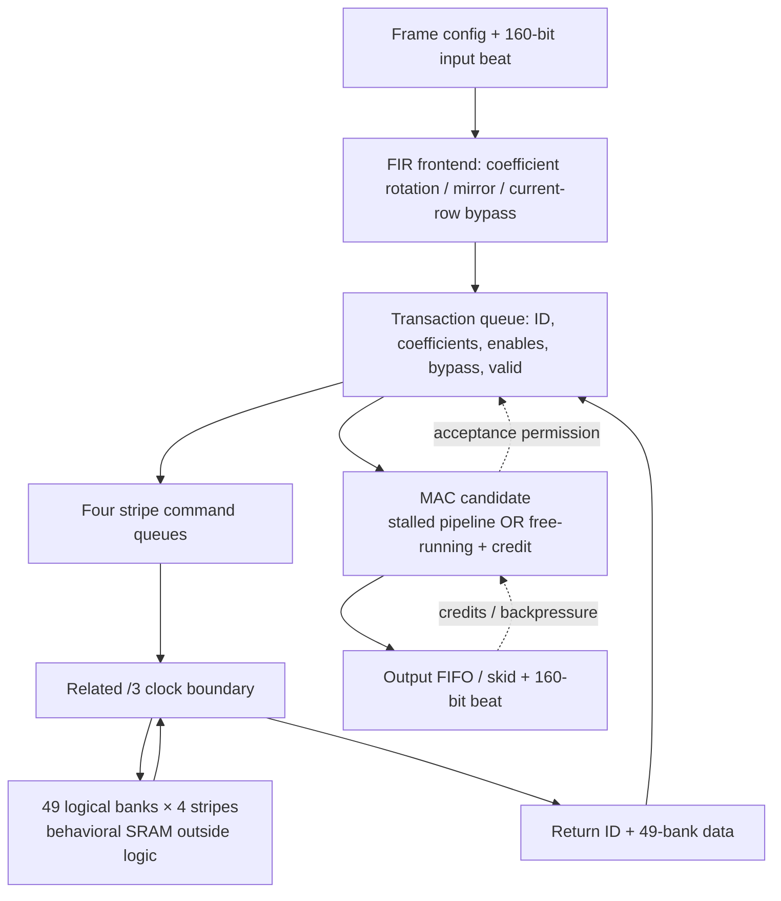

# Architecture and design decisions

## Requirements and scope

目标是 1 ns 外部核心时钟、连续 4 pixels/cycle 的垂直 FIR；当前只是功能吞吐通过，
完整电路未满足该频率。每 pixel=RGBA×10 bits，每 beat=160 bits；奇数 kernel 1～49，
系数非负、中心对称、归一化和为128，输入配置在一帧内固定。图像宽高寄存器传 W−1/H−1。

验证覆盖的最小宽高为24、最大测试宽1440；还覆盖奇数尺寸、所有25种kernel与反压。
端口能编码更大尺寸不等于本候选已验证全部尺寸；不要将测试范围推广到所有编码值。
49 logical banks 分别按行模49分配；每个行内 beat 以地址低2位选择四个条带，
其余地址位为条带内地址。模型每条带128×160 bits，共49×4个行为存储体，不是已布置的宏。

性能以 accepted/consumed beat 计数；延迟分三部分：启动填充/边界准备、存储事务排队、
MAC 与输出排队。反压下没有固定端到端墙钟延迟。无反压的持续输出有断言检查。

## Data flow and ownership



每个事务把系数、使能、旁路、是否输出与读数据绑在一起；返回 ID 只能完成仍分配给
该请求的 slot，队头完成后才有序退休。存储写入也要完成通知，不能只等待 read response。
复位取消整帧与所有在途 valid/信用；payload/SRAM 内容不复位，但不得在无 valid 时消费。

`fir_transaction_queue.sv` 是完整顶层使用的49-bank队列；
`striped_sram_scheduler.sv` 是保留的单bank通道调度实验，不要误把它当完整 FIR。

## Related clock: explicit but not signed off

唯一参考源是核心 clk。`sram_related_boundary.sv` 用 core 上升沿 phase 状态，
在下降沿寄存 SRAM clock，形成 /3、名义 high=1T、low=2T 的相关时钟。
不是异步 CDC，不通过 asynchronous false-path 消掉命令/数据路径。

在 T=1 ns 的行为仿真中：

| 事件 | 名义关系 / 检查 |
| --- | --- |
| SRAM command 寄存 | 与 SRAM launch 保持约1.5T 的 setup/hold窗口 |
| SRAM clock | 周期3T，high1T，low2T |
| 行为 read tCO | 1.8 ns；错误模型负对照为3.2 ns |
| 返回 capture | launch 后2.5T，下一次 SRAM launch 前0.5T |
| reset | 外部 arst_n 异步断言，内部两级同步释放；清除所有事务状态 |

这些只是 RTL/model 的相位契约。真实 capture 前旧数据是否保持，仍取决于 SRAM
min/max tCQ、输出行为、生成时钟插入延迟、skew、jitter 和真实布线 RC。
私有全核筛查没有伪造 SRAM IO 预算，因此不能宣称这些物理路径已经覆盖或通过。

## Arithmetic contract and alternatives

数学输出：
```text
Y = sat10((64 + Σ a[k] * X[mirror(y+k), x, component]) >> 7)
C[bank] = Σ coefficients whose mirrored row maps to that bank
```

将映射移到系数准备阶段，使 bank 数据位置固定。每 lane 有50个乘法输入位置，
包含49个bank槽及当前行旁路，使用使能避免重复计入。16 lane并行。

局部新 MAC 采用17-bit非负有效和：
1023×128+64=131008<2^17。这个截位依赖总权重≤128；它不是任意有符号 CNN MAC。
prefix 保持9个使能周期；segmented20、mask21、deep32为32。
深流水缩短局部进位，却增加面积、时钟与停顿使能负载，不能只优化一个 WNS。

## Credit invariant

自由运行计算不直接受外部 ready 控制。输入握手时先预留最终输出位置：

```text
reserved = accepted inputs - consumed outputs
stored   = produced outputs - consumed outputs
0 <= stored <= reserved <= DEPTH (64)
```

reserved 包含在流水中的事务。即便输出突然停住，所有在途结果仍有位置可写。
只有 valid && ready 才移动事务，不能把输入 ready 强行固定为1。
one-hot版本用one-hot读写指针、stored/reserved和树状OR读选择减少进位链，
代价是更多状态/组合选择。断言检查容量、one-hot、顺序与排空。

## Decisions, failure handling, and revisit points

| 决策 | 收益 | 代价 / 何时重新评估 |
| --- | --- | --- |
| 冻结前端，生成新顶层 | 可比较、避免静默改动基线 | 文本锚点/哈希变化应失败；未来改结构生成器 |
| 分级筛查，不对所有候选DRT | 控制计算预算 | 早期RC只供相对研究；最终需新SPEF |
| 信用队列代替巨型全局stall | 数据通路与ready解耦 | FIFO/完成译码仍是瓶颈，应继续局部分发 |
| 模型在仓库外，hash锁定 | 不泄漏受限模型、避免角别混淆 | 公众没有授权模型只能复现功能层 |
| 每次新输出目录，阶段超时 | 保存失败日志、不污染历史 | 未写盘的工具内存状态不可续跑 |
| SS/TT/FF独立进程STA | 明确加载的library | 没有真正多RC/MMMC签核资格 |

已观测的完整 core 最差路径 ret_id→done 表明返回译码仍需优化。
本仓库不声称服务级HA/分布式队列能力；“重试”是实验执行器对已保存输入和检查点的
显式新跑次，不是硬件自动重发请求。每次保存命令、退出码、超时、日志hash和可用峰值RSS。

